  

# `> GABRIEL SAMPAIO_`

 

## `// SOBRE_MIM`

Sou desenvolvedor com foco em **Back-end**, interessado em construir aplicações 

Desenvolvo projetos próprios para aprofundar meus conhecimentos em engenharia de software, explorando desde modelagem de domínio e arquitetura até persistência de dados, integração entre serviços e testes automatizados.

### `> foco_atual`

| Área | O que estou estudando |
| :-- | :-- |
| **Arquitetura de Software** | Clean Architecture, DDD e padrões de projeto |
| **Back-end** | APIs REST e aplicações com Node.js e TypeScript |
| **Banco de Dados** | Modelagem, persistência, consistência e gerenciamento de dados |
| **Fundamentos da Computação** | Estruturas de dados, algoritmos e resolução de problemas |

 

## `// STACK`

| | |
| :-- | :-- |
| **Linguagens** |     |
| **Back-end & Bancos** |      |
| **Mobile** |  |
| **Ferramentas** |      |

 

## `// PROJETOS_EM_DESTAQUE`

### LedgerFlow
> API de gerenciamento de crédito para pequenos negócios.

Sistema para gerenciar operações de crédito e movimentações financeiras, usando **Event Sourcing** para manter um histórico imutável de transações e permitir a reconstrução do saldo dos clientes.

- **Event Sourcing** para persistência e rastreabilidade das transações
- **Clean Architecture** e **Domain-Driven Design (DDD)**
- **Strategy** e **Factory** para encapsular estratégias de cálculo de taxas
- Testes unitários, de integração e ponta a ponta (E2E)
- Containerização do ambiente com **Docker**

 

### Cinema Reservation System
> API de gerenciamento de cinemas e reservas de assentos.

Voltado à administração de cinemas, filmes, salas, sessões e reservas. Explora modelagem de domínio, regras de negócio e controle de estados em um fluxo de reservas.

- **Clean Architecture** e **DDD**
- **Repository Pattern** e **DTO Pattern**
- Organização modular orientada aos domínios da aplicação
- Ciclo de vida das reservas: `HOLD` → `CONFIRMED` · `CANCELLED` · `EXPIRED`
- Planejamento de estratégias de cache e processamento assíncrono

 

### Asset Batch Manager
> Aplicação mobile para gestão e rastreabilidade de ativos.

Voltada ao gerenciamento de ativos laboratoriais e operacionais, com abordagem **offline-first**: registra movimentações sem internet e sincroniza os dados depois.

- Arquitetura inspirada em **Clean Architecture** e **MVVM**
- **DDD** aplicado à modelagem das regras de negócio
- Separação de responsabilidades entre domínio, interface e infraestrutura
- Validação de tipos e estados dos ativos
- **Firebase** como camada de cache offline e buffer de sincronização
- Estrutura preparada para múltiplas empresas e auditoria

 

## `// LEETCODE`

Utilizo o LeetCode para praticar resolução de problemas, fortalecer minha lógica de programação e aprofundar conhecimentos em estruturas de dados e algoritmos.

<a href="https://leetcode.com/u/gabrielsampaios/"><b>[ visitar perfil no LeetCode → ]</b></a>

 

## `// CONTATO`

Estou aberto a trocar conhecimentos, conversar sobre desenvolvimento de software e conhecer novas oportunidades.

| Canal | Link |
| :-- | :-- |
| **E-mail** | [gabrielssampio42@gmail.com](mailto:gabrielssampio42@gmail.com) |
| **LinkedIn** | [Gabriel Sampaio](https://linkedin.com/in/gabriel-sampaio0122/) |
| **LeetCode** | [gabrielsampaios](https://leetcode.com/u/gabrielsampaios/) |

 

<!--

-->

